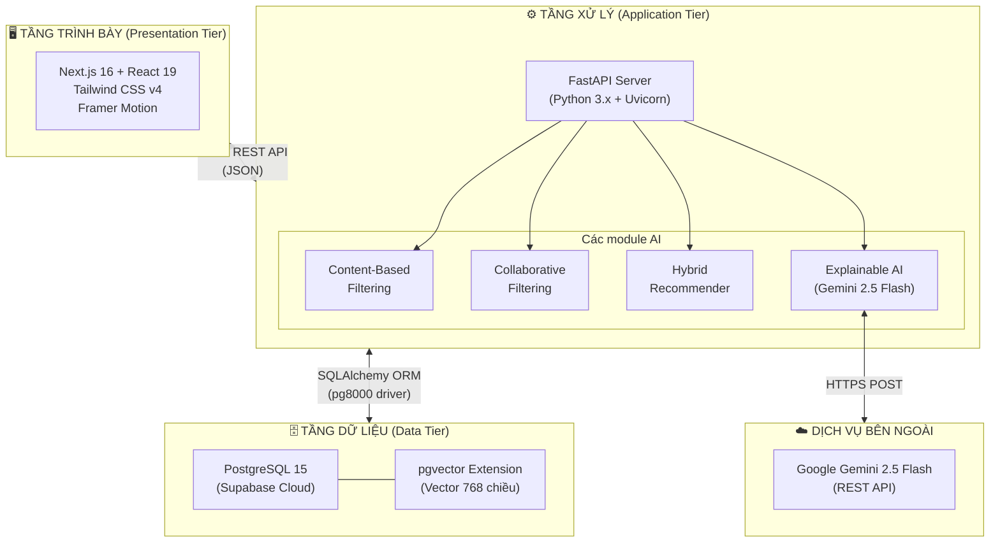
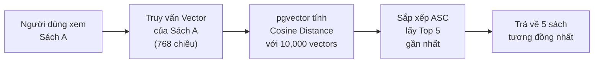
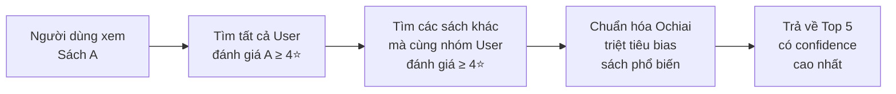
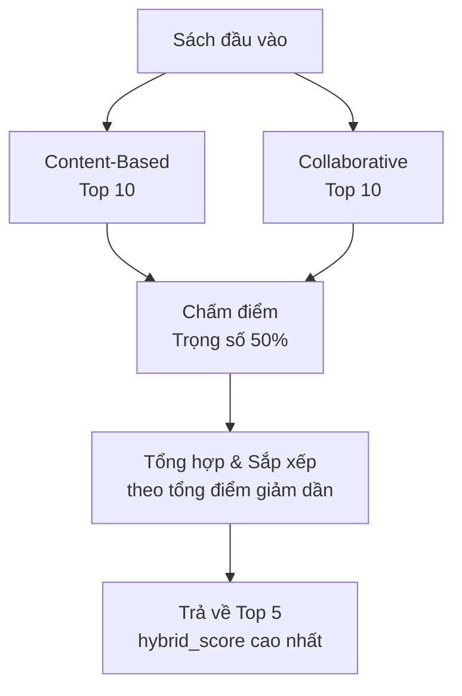
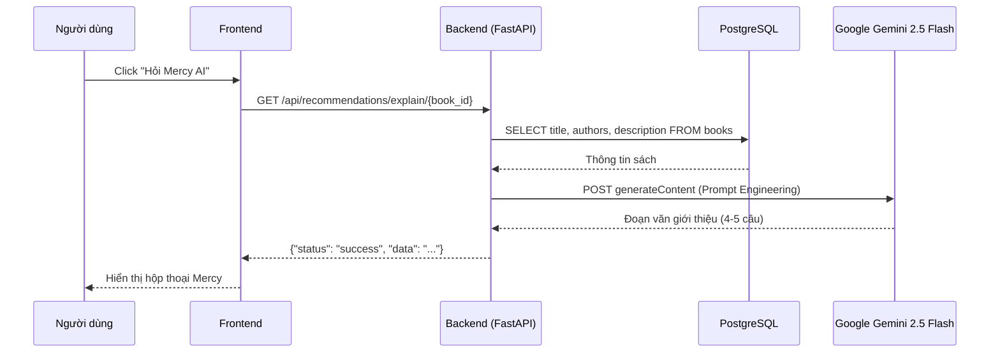
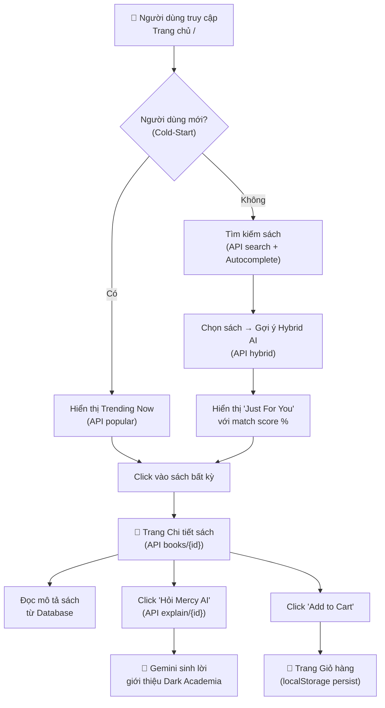

# KẾT QUẢ XÂY DỰNG HỆ THỐNG GỢI Ý SÁCH THÔNG MINH
## "The Inkwell" — AI-Powered Book Recommendation System

---

## 1. TỔNG QUAN KIẾN TRÚC HỆ THỐNG

Hệ thống The Inkwell được xây dựng theo kiến trúc **Client-Server** 3 tầng (Three-tier Architecture), tích hợp 4 mô hình AI phục vụ bài toán gợi ý sách cá nhân hóa.



### Mô tả tổng quan:
- **Tầng trình bày (Frontend):** Ứng dụng Single Page Application xây dựng bằng Next.js 16 với React 19, giao diện người dùng được thiết kế theo phong cách Dark Academia, sử dụng Tailwind CSS v4 và Framer Motion cho hiệu ứng chuyển động.
- **Tầng xử lý (Backend):** Máy chủ FastAPI cung cấp 8 RESTful API endpoints, tích hợp 4 module AI xử lý logic gợi ý sách.
- **Tầng dữ liệu (Database):** PostgreSQL 15 trên Supabase Cloud (AWS Singapore), mở rộng pgvector để lưu trữ và truy vấn vector embedding 768 chiều.
- **Dịch vụ bên ngoài:** Google Gemini 2.5 Flash API phục vụ tính năng Explainable AI (giải thích lý do gợi ý).

---

## 2. THIẾT KẾ CƠ SỞ DỮ LIỆU

### 2.1 Sơ đồ ERD (Entity-Relationship Diagram)

```mermaid
erDiagram
    USERS {
        int user_id PK
        string username UK
        string email UK
        datetime created_at
    }

    BOOKS {
        int book_id PK
        int goodreads_book_id UK
        string authors
        string original_title
        string title
        string language_code
        string image_url
        string small_image_url
        string description
        vector embedding "Vector(768)"
    }

    RATINGS {
        int rating_id PK
        int user_id FK
        int book_id FK
        int rating
        datetime created_at
    }

    TAGS {
        int tag_id PK
        string tag_name UK
    }

    BOOK_TAGS {
        int id PK
        int book_id FK
        int tag_id FK
        int count
    }

    INTERACTIONS {
        int id PK
        int user_id FK
        int book_id FK
        string interaction_type "view/click/purchase/add_to_cart"
        datetime created_at
    }

    RECOMMENDATION_CACHE {
        int id PK
        int user_id FK
        string model_version
        array book_ids "ARRAY(Integer)"
        array scores "ARRAY(Float)"
        datetime generated_at
    }

    POPULAR_BOOKS {
        int book_id PK_FK
        float score
        int rank
        datetime updated_at
    }

    USERS ||--o{ RATINGS : "đánh giá"
    USERS ||--o{ INTERACTIONS : "tương tác"
    USERS ||--o{ RECOMMENDATION_CACHE : "lưu cache"
    BOOKS ||--o{ RATINGS : "được đánh giá"
    BOOKS ||--o{ BOOK_TAGS : "gắn thẻ"
    BOOKS ||--o{ INTERACTIONS : "được tương tác"
    BOOKS ||--|| POPULAR_BOOKS : "xếp hạng"
    TAGS ||--o{ BOOK_TAGS : "phân loại"
```

### 2.2 Thống kê dữ liệu hiện tại

| Bảng | Số bản ghi | Mô tả |
|------|-----------|-------|
| `books` | **10,000** | Dữ liệu sách từ Goodreads, bao gồm vector embedding 768 chiều |
| `ratings` | **~981,756** | Dữ liệu đánh giá sách của người dùng (thang điểm 1-5) |
| `tags` | **~34,252** | Thẻ phân loại thể loại sách |
| `book_tags` | **~999,912** | Bảng liên kết sách-thẻ với trọng số |
| `popular_books` | **~10,000** | Bảng xếp hạng sách trending (cold-start) |

---

## 3. CÁC THUẬT TOÁN AI ĐÃ CÀI ĐẶT

### 3.1 Content-Based Filtering (Lọc dựa trên Nội dung)

**Nguyên lý hoạt động:** Sử dụng vector embedding 768 chiều (được tạo bởi mô hình Google Gemini) để biểu diễn nội dung ngữ nghĩa của mỗi cuốn sách. Khi người dùng xem một cuốn sách, hệ thống tìm các cuốn có vector gần nhất bằng phép đo **Cosine Similarity** trực tiếp trên PostgreSQL thông qua toán tử `<=>` của pgvector.

**Công thức toán học:**

$$\text{Cosine Similarity}(\vec{A}, \vec{B}) = \frac{\vec{A} \cdot \vec{B}}{||\vec{A}|| \times ||\vec{B}||} = \frac{\sum_{i=1}^{768} A_i B_i}{\sqrt{\sum_{i=1}^{768} A_i^2} \times \sqrt{\sum_{i=1}^{768} B_i^2}}$$

**Câu truy vấn SQL lõi:**
```sql
SELECT book_id, title, image_url
FROM books
WHERE embedding IS NOT NULL AND book_id != :current_book_id
ORDER BY embedding <=> cast(:current_embedding AS vector)
LIMIT 5
```

> [!NOTE]
> Toán tử `<=>` là toán tử khoảng cách Cosine của pgvector. Nó trả về giá trị **khoảng cách** (distance), do đó sắp xếp `ASC` (tăng dần) sẽ cho ra các sách có nội dung **gần giống nhất**.

**Luồng xử lý:**



---

### 3.2 Collaborative Filtering (Lọc Cộng tác)

**Nguyên lý hoạt động:** Dựa trên hành vi đánh giá của cộng đồng người dùng. Nếu hai cuốn sách A và B cùng được nhiều người dùng đánh giá cao (≥ 4 sao), chúng được coi là "có liên quan". Sử dụng **hệ số Ochiai** (biến thể của Cosine Similarity trên tập hợp) để chuẩn hóa, triệt tiêu bias của sách quá phổ biến.

**Công thức Ochiai Coefficient:**

$$\text{Ochiai}(A, B) = \frac{|U_A \cap U_B|}{\sqrt{|U_A| \times |U_B|}}$$

Trong đó:
- \(U_A\): Tập hợp người dùng đánh giá sách A ≥ 4 sao
- \(U_B\): Tập hợp người dùng đánh giá sách B ≥ 4 sao
- \(|U_A \cap U_B|\): Số người dùng cùng đánh giá cao cả A và B

**Câu truy vấn SQL lõi (sử dụng CTE):**
```sql
WITH co_occurrences AS (
    -- Tìm tất cả sách khác được cùng người dùng đánh giá cao
    SELECT r2.book_id, COUNT(r2.user_id) AS co_count
    FROM ratings r1
    JOIN ratings r2 ON r1.user_id = r2.user_id
    WHERE r1.book_id = :book_id 
      AND r1.rating >= 4 
      AND r2.rating >= 4
      AND r2.book_id != :book_id
    GROUP BY r2.book_id
)
SELECT 
    b.book_id, b.title, b.image_url, 
    ROUND(CAST(
        (c.co_count / SQRT(
            (SELECT COUNT(*) FROM ratings WHERE book_id = :book_id AND rating >= 4) * 
            (SELECT COUNT(*) FROM ratings WHERE book_id = c.book_id AND rating >= 4)
        )) AS NUMERIC
    ), 4) AS confidence_score
FROM co_occurrences c
JOIN books b ON c.book_id = b.book_id
ORDER BY confidence_score DESC
LIMIT 5
```

> [!NOTE]
> Việc chuẩn hóa bằng Ochiai rất quan trọng: nếu chỉ đếm `co_count`, các sách bán chạy như Harry Potter sẽ luôn xuất hiện bất kể sách đầu vào là gì. Ochiai chia cho căn bậc hai tích số lượt đánh giá, triệt tiêu hiệu ứng "popularity bias".

**Luồng xử lý:**



---

### 3.3 Hybrid Recommender (Hệ gợi ý Lai)

**Nguyên lý hoạt động:** Kết hợp kết quả từ cả hai thuật toán Content-Based và Collaborative Filtering bằng phương pháp **Rank-based Scoring** (chấm điểm dựa trên vị trí xếp hạng). Mỗi thuật toán đóng góp trọng số **50%**.

**Công thức chấm điểm:**

$$\text{Score}(book) = \sum_{model \in \{CB, CF\}} (N - rank_{model}(book)) \times w_{model}$$

Trong đó:
- \(N = 10\) (lấy top 10 từ mỗi thuật toán)
- \(rank_{model}(book)\): Vị trí xếp hạng của sách trong kết quả của mỗi thuật toán (0-indexed)
- \(w_{CB} = w_{CF} = 0.5\) (trọng số bằng nhau)

**Ví dụ minh họa:**

| Sách | Rank CB | Điểm CB | Rank CF | Điểm CF | **Tổng điểm** |
|------|---------|---------|---------|---------|---------------|
| Sách X | #1 | (10-0)×0.5 = 5.0 | #3 | (10-2)×0.5 = 4.0 | **9.0** |
| Sách Y | #2 | (10-1)×0.5 = 4.5 | #1 | (10-0)×0.5 = 5.0 | **9.5** ✨ |
| Sách Z | — | 0 | #2 | (10-1)×0.5 = 4.5 | **4.5** |

→ Sách Y đứng đầu vì xuất hiện ở cả hai danh sách với tổng điểm cao nhất.

**Luồng xử lý:**



---

### 3.4 Explainable AI — Mercy (Cố vấn Văn học AI)

**Nguyên lý hoạt động:** Sử dụng mô hình ngôn ngữ lớn **Google Gemini 2.5 Flash** thông qua REST API để sinh lời giải thích tại sao một cuốn sách đáng đọc. Hệ thống áp dụng kỹ thuật **Prompt Engineering** chuẩn (System Role / Context / Task / Constraints) để kiểm soát chất lượng đầu ra.

**Kiến trúc Prompt:**

| Thành phần | Mục đích |
|-----------|---------|
| `[SYSTEM ROLE]` | Định nghĩa nhân cách AI: "Mercy — Cố vấn Văn học AI của The Inkwell" |
| `[CONTEXT]` | Cung cấp dữ liệu thực: tên sách, tác giả, tóm tắt gốc từ Goodreads |
| `[TASK]` | 3 mục tiêu: khơi gợi giá trị, thuyết phục, thúc đẩy hành vi mua |
| `[CONSTRAINTS & TONE]` | Giới hạn: 4-5 câu, văn phong Dark Academia, không spoiler, tiếng Việt |

**Luồng xử lý:**



---

## 4. TÀI LIỆU API (API Documentation)

### 4.1 Tổng quan các Endpoints

| # | Method | Endpoint | Mô tả |
|---|--------|----------|-------|
| 1 | `GET` | `/` | Kiểm tra trạng thái máy chủ |
| 2 | `GET` | `/api/recommendations/popular` | Danh sách sách trending (Cold-start) |
| 3 | `GET` | `/api/recommendations/similar/{book_id}` | Gợi ý Content-Based (pgvector) |
| 4 | `GET` | `/api/recommendations/collaborative/{book_id}` | Gợi ý Collaborative Filtering |
| 5 | `GET` | `/api/recommendations/hybrid/{book_id}` | Gợi ý Hybrid (kết hợp lai) |
| 6 | `GET` | `/api/books/search` | Tìm kiếm sách (Autocomplete) |
| 7 | `GET` | `/api/books/{book_id}` | Chi tiết một cuốn sách |
| 8 | `GET` | `/api/recommendations/explain/{book_id}` | Explainable AI (Mercy) |

---

### 4.2 Chi tiết từng Endpoint

#### API 1: Health Check
```
GET /
```
**Response:**
```json
{
  "message": "Chào mừng đến với hệ thống AI của The Inkwell!"
}
```

---

#### API 2: Sách Thịnh Hành (Cold-Start)
```
GET /api/recommendations/popular?limit=10
```
**Mục đích:** Giải quyết bài toán Cold-Start — khi người dùng mới truy cập lần đầu, hệ thống chưa có dữ liệu hành vi để cá nhân hóa, do đó hiển thị danh sách sách phổ biến nhất.

**Parameters:**

| Tham số | Kiểu | Mặc định | Mô tả |
|---------|------|---------|-------|
| `limit` | int | 20 | Số lượng sách trả về |

**Response mẫu:**
```json
{
  "data": [
    {
      "book_id": 1,
      "title": "The Hunger Games",
      "author": "Suzanne Collins",
      "image_url": "https://images.gr-assets.com/books/...",
      "score": 4.34,
      "rank": 1
    }
  ]
}
```

---

#### API 3: Content-Based Filtering
```
GET /api/recommendations/similar/{book_id}
```
**Mục đích:** Tìm 5 cuốn sách có nội dung ngữ nghĩa tương đồng nhất bằng vector embedding 768 chiều.

**Response mẫu:**
```json
{
  "status": "success",
  "message": "Tìm thấy 5 cuốn sách tương đồng bằng AI",
  "data": [
    {
      "book_id": 2,
      "title": "Catching Fire",
      "image_url": "https://images.gr-assets.com/books/..."
    }
  ]
}
```

---

#### API 4: Collaborative Filtering
```
GET /api/recommendations/collaborative/{book_id}
```
**Mục đích:** Gợi ý sách dựa trên hành vi đánh giá của cộng đồng, chuẩn hóa bằng hệ số Ochiai.

**Response mẫu:**
```json
{
  "status": "success",
  "message": "Tìm thấy 5 cuốn sách dựa trên hành vi người dùng",
  "data": [
    {
      "book_id": 3,
      "title": "Mockingjay",
      "image_url": "https://images.gr-assets.com/books/...",
      "confidence_score": 0.8721
    }
  ]
}
```

---

#### API 5: Hybrid Recommender
```
GET /api/recommendations/hybrid/{book_id}
```
**Mục đích:** Kết hợp kết quả Content-Based và Collaborative Filtering theo phương pháp Rank-based Scoring.

**Response mẫu:**
```json
{
  "status": "success",
  "message": "Tìm thấy 5 cuốn sách dựa trên thuật toán Lai (Hybrid)",
  "data": [
    {
      "book_id": 2,
      "title": "Catching Fire",
      "image_url": "https://images.gr-assets.com/books/...",
      "hybrid_score": 9.5
    }
  ]
}
```

---

#### API 6: Tìm kiếm Sách (Autocomplete)
```
GET /api/books/search?q=hunger&limit=5
```
**Mục đích:** Tìm kiếm sách theo tên phục vụ chức năng autocomplete trên thanh tìm kiếm.

**Parameters:**

| Tham số | Kiểu | Mặc định | Mô tả |
|---------|------|---------|-------|
| `q` | string | — | Từ khóa tìm kiếm (tối thiểu 2 ký tự) |
| `limit` | int | 5 | Số lượng kết quả trả về |

**Response mẫu:**
```json
{
  "data": [
    {
      "book_id": 1,
      "title": "The Hunger Games",
      "author": "Suzanne Collins",
      "image_url": "https://images.gr-assets.com/books/..."
    }
  ]
}
```

---

#### API 7: Chi tiết Sách
```
GET /api/books/{book_id}
```
**Mục đích:** Lấy toàn bộ thông tin chi tiết của một cuốn sách để hiển thị trên trang Book Detail.

**Response mẫu:**
```json
{
  "status": "success",
  "data": {
    "book_id": 1,
    "title": "The Hunger Games",
    "author": "Suzanne Collins",
    "image_url": "https://images.gr-assets.com/books/...",
    "description": "In the ruins of a place once known as North America...",
    "language_code": "eng"
  }
}
```

---

#### API 8: Explainable AI (Mercy)
```
GET /api/recommendations/explain/{book_id}
```
**Mục đích:** Gọi Google Gemini 2.5 Flash để sinh lời giải thích tại sao cuốn sách đáng đọc, đóng vai "Mercy — Cố vấn Văn học AI".

**Response mẫu:**
```json
{
  "status": "success",
  "data": "Có bao giờ bạn tự hỏi, điều gì xảy ra khi sự sinh tồn trở thành một trò chơi và nhân tính là thứ xa xỉ nhất? Suzanne Collins đã dệt nên một thế giới nơi mỗi trang sách là một lời cảnh tỉnh sâu sắc về quyền lực, hy sinh và bản năng con người..."
}
```

---

## 5. GIAO DIỆN NGƯỜI DÙNG (Frontend)

### 5.1 Các trang đã hoàn thiện

| Trang | Đường dẫn | Chức năng chính |
|-------|-----------|----------------|
| **Trang chủ** | `/` | Hero section + Thanh tìm kiếm Autocomplete + Khu vực "Just For You" (Hybrid AI) + Khu vực "Trending Now" (Cold-start) |
| **Chi tiết sách** | `/books/[id]` | Bố cục 3 cột kiểu Amazon (Ảnh bìa / Thông tin & Mô tả / Hộp mua hàng) + Nút Explainable AI |
| **Giỏ hàng** | `/cart` | Danh sách sản phẩm + Tăng/giảm số lượng + Tóm tắt đơn hàng |

### 5.2 Các Component tái sử dụng

| Component | Chức năng |
|-----------|----------|
| `Navbar` | Thanh điều hướng cố định với logo, menu, biểu tượng giỏ hàng (hiển thị badge số lượng real-time) |
| `Footer` | Chân trang với thông tin thương hiệu và liên kết |
| `BookCard` | Thẻ sách hiển thị ảnh bìa, tiêu đề, tác giả, đánh giá sao, giá, badge xếp hạng và điểm AI match |

### 5.3 Luồng tương tác người dùng End-to-End



---

## 6. CÔNG NGHỆ SỬ DỤNG

### 6.1 Backend

| Công nghệ | Phiên bản | Vai trò |
|-----------|----------|---------|
| Python | 3.x | Ngôn ngữ lập trình chính |
| FastAPI | Latest | Web framework (REST API) |
| Uvicorn | Latest | ASGI Server |
| SQLAlchemy | Latest | ORM (Object-Relational Mapping) |
| pg8000 | Latest | PostgreSQL driver (pure Python) |
| pgvector | Latest | Extension tìm kiếm vector similarity |
| Pandas / NumPy | Latest | Xử lý và phân tích dữ liệu |
| scikit-learn | Latest | Tiền xử lý dữ liệu ML |
| Requests | Latest | HTTP client gọi Gemini API |

### 6.2 Frontend

| Công nghệ | Phiên bản | Vai trò |
|-----------|----------|---------|
| Next.js | 16.3.8 | React framework (SSR/CSR) |
| React | 19.2.8 | UI component library |
| Tailwind CSS | v4 | Utility-first CSS framework |
| Framer Motion | 14.0.0 | Animation library |
| Lucide React | 1.52.0 | Icon library |
| TypeScript | 5.x | Type-safe JavaScript |

### 6.3 Database & Cloud

| Công nghệ | Vai trò |
|-----------|---------|
| PostgreSQL 15 | Relational database |
| pgvector Extension | Vector similarity search |
| Supabase (AWS Singapore) | Database hosting & pooling |

### 6.4 AI / Machine Learning

| Mô hình | Vai trò |
|---------|---------|
| Google Gemini Embedding | Tạo vector embedding 768 chiều cho 10,000 cuốn sách |
| Google Gemini 2.5 Flash | Sinh lời giải thích (Explainable AI) |
| Cosine Similarity (pgvector) | Đo độ tương đồng nội dung sách |
| Ochiai Coefficient (SQL) | Đo độ tương đồng hành vi cộng đồng |
| Rank-based Fusion | Kết hợp lai hai thuật toán gợi ý |

---

## 7. TÓM TẮT KẾT QUẢ ĐẠT ĐƯỢC

| Hạng mục | Kết quả |
|----------|---------|
| Tổng số API endpoints | **8** endpoints RESTful |
| Tổng số thuật toán AI | **4** mô hình (CB + CF + Hybrid + XAI) |
| Tổng số sách trong hệ thống | **10,000** cuốn (Goodreads dataset) |
| Kích thước vector embedding | **768 chiều** / cuốn sách |
| Tổng số bảng cơ sở dữ liệu | **8** bảng (PostgreSQL) |
| Tổng số trang giao diện | **3** trang + **3** components tái sử dụng |
| Mô hình ngôn ngữ lớn (LLM) | Google Gemini 2.5 Flash |
| Kỹ thuật Prompt Engineering | System/Context/Task/Constraints (4 thành phần) |
| Phương pháp Cold-Start | Popularity-based ranking |
| Phương pháp chống Bias | Ochiai normalization |
